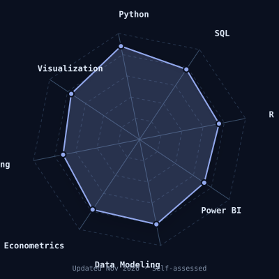
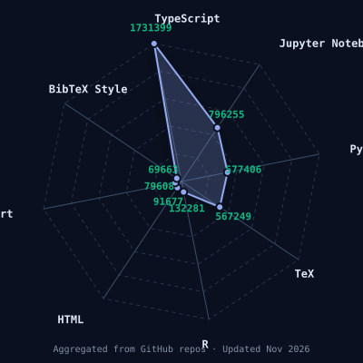
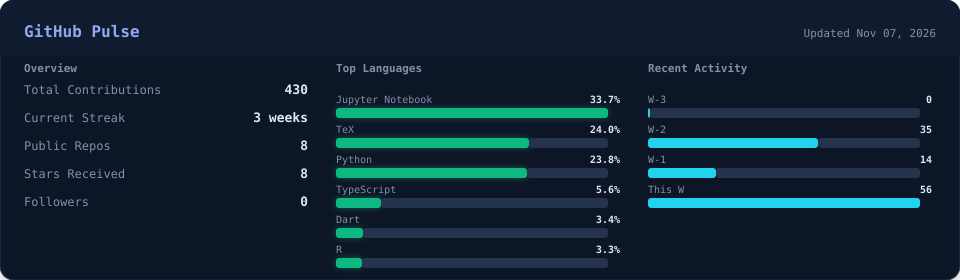
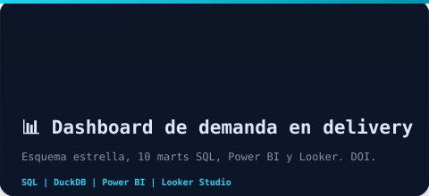
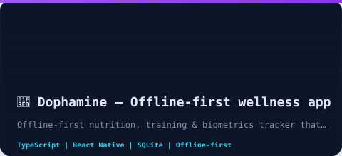
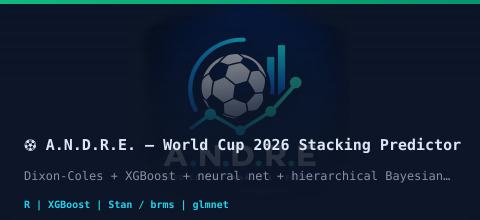
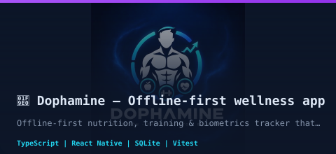

<!-- BANNER -->

 

<!-- NAME / TAGLINE -->

 

<!-- SOCIALS -->

 

<a href="README.md">English</a> · <b>Español</b>

---

  
📚 Tabla de Contenidos

  
  - [Este soy yo :)](#este-soy-yo-)
  - [En construcción](#en-construcción)
  - [Publicaciones](#publicaciones)
  - [En qué ando pensando](#en-qué-ando-pensando)
  - [Mi stack ideal](#mi-stack-ideal)
  - [Radar de habilidades](#radar-de-habilidades)
  - [Pulso](#pulso)
  - [Proyectos destacados](#proyectos-destacados)
  

## Este soy yo :)

Hola, soy **Andre** (Jharol André Vilca Ramos), estudiante de doble carrera en Ingeniería Industrial y Ciencia de Datos, desde Lima, Perú 🇵🇪.
Construyo pipelines SQL, modelos y dashboards que convierten datos operativos desordenados en decisiones accionables, con el rigor de la ingeniería industrial aplicado a problemas de ciencia de datos.

Soy lector inquieto: leo papers sobre equidad en IA, economía conductual, psicología de la decisión, ingeniería ambiental, informática jurídica y ciencias del ejercicio, lo que me llame la atención ese día.

- 🎓 **Estudiante**: Ingeniería Industrial + Ciencia de Datos (doble carrera)
- 📍 **Ubicación**: Lima, Perú
- 🏢 **Rol objetivo**: Analista de Datos Junior / Practicante BI
- 📊 **Uso diario**: Python (Pandas, scikit-learn, statsmodels), R (XGBoost, Stan/brms), TypeScript
- 🗄️ **Stack BI**: SQL (DuckDB: CTE, funciones de ventana, modelo estrella), Power BI (DAX), Looker Studio
- 🧪 **Intereses de investigación**: ética y equidad en IA, neurociencia de la decisión, economía conductual, sostenibilidad ambiental, informática jurídica, ciencias del ejercicio, métodos de ensamble para predicción
- 📝 **Redacción académica**: LaTeX (IEEE, APA 7), informes reproducibles con DOI en Zenodo y [ResearchGate](https://www.researchgate.net/profile/Jharol-Vilca-Ramos) — ver [Publicaciones](#publicaciones)

 

## 🔮 En construcción

| Proyecto | Descripción | Estado | Stack |
|---|---|---|---|
| [`dashboard-demanda-delivery`](https://github.com/s7ex-j/dashboard-demanda-delivery) | Modelo estrella en DuckDB, 10 marts SQL, 17 reglas de calidad de datos y tests; Power BI (DAX) + [Looker Studio] público(https://lookerstudio.google.com/reporting/26c68f6d-8127-45d0-81d8-99ef04342e32) · [DOI](https://doi.org/10.5281/zenodo.23753183) | ✅ v1.0.0 | SQL · DuckDB · Power BI · Looker Studio |
| [`demanda-delivery-v2`](https://github.com/s7ex-j/demanda-delivery-v2) | Elasticidad precio-demanda en delivery de comidas (456 mil obs.): OLS, panel con efectos fijos, IV, splines · [DOI](https://doi.org/10.5281/zenodo.23586040) | ✅ v3.3.0 | Python · statsmodels · linearmodels · LaTeX |
| [`A.N.D.R.E.`](https://github.com/s7ex-j/A.N.D.R.E-Modelo-predictivo-mundiales) | Predictor de partidos de fútbol con stacking de modelos (Mundial 2026) | ⚡ Activo | R · XGBoost · Stan/brms · plumber |
| [`dophamine`](https://github.com/s7ex-j/Dophamine) | App de bienestar offline-first: nutrición, entrenamiento y biometría con resúmenes semanales · [sitio](https://s7ex-j.github.io/Dophamine/) · [app web](https://s7ex-j.github.io/Dophamine/app/) | 🚀 v0.3.0 | TypeScript · React Native · SQLite |
| [`theyso`](https://github.com/s7ex-j/theyso) | Control remoto autoalojado de Claude Code / OpenCode desde el celular: servidor local + app Flutter, sin nube de por medio | 🚀 v0.1.2 | Python · WebSockets · Flutter · Tailscale |
| [`LaTeX Templates`](https://github.com/s7ex-j/plantillas-latex-ieee-apa7) | Plantillas de redacción académica según las normas IEEE y APA 7 | ✅ Mantenimiento | LaTeX · IEEE · APA 7 |

---

## 📄 Publicaciones

**Elasticidad precio-demanda en el servicio de delivery de comidas: evidencia desde datos transaccionales** (2026). Documento de trabajo, v3.3.0.
Elasticidad precio-demanda en una plataforma de delivery con 456 548 observaciones semana × centro × plato: OLS, efectos fijos de dos vías, IV 2SLS, splines cúbicos restringidos y regresión cuantil. Hallazgo principal: la elasticidad no es un solo número; varía con el nivel de precio, la categoría, la semana y la estrategia de identificación.
  

**Dashboard de demanda en delivery: SQL (DuckDB), Power BI y Looker Studio** (2026). Software, v1.0.0.
Capa de datos y dashboards sobre el mismo dataset de 456 548 filas: modelo estrella, 10 consultas de negocio con CTE y funciones de ventana (ABC, cohortes, índice de promoción, deciles de precio), 17 reglas de calidad que detienen el pipeline y tests que concilian cada cifra con el estudio anterior.
  

**Informe Técnico: Caracterización Fisicoquímica de Suelos Urbanos del Parque Kennedy** (2026). Informe técnico.
 

---

## 💡 En qué ando pensando

Ahora mismo, Andre está metido de lleno en:
- **Ingeniería Industrial + IA**: optimizar sistemas con decisiones basadas en datos
- **Inferencia causal**: contrafactuales para medir impacto real
- **Analítica de fútbol / xG**: métodos de ensamble para predecir partidos
- **IA en documentos legales**: NLP para analizar contratos (proyecto paralelo)
- **Neurociencia de la decisión**: lo que el cerebro dice sobre cómo elegimos
- **Ciencias del ejercicio y nutrición**: seguimiento de bienestar con datos

 

---

## Mi stack ideal

<!-- Using shields.io tech badges - reliable and theme-aware -->

  

BI e ingeniería de datos 

---

## 🧩 Radar de habilidades

<table>
<tr>
<td width="50%" align="center" valign="middle">

</td>
<td width="50%" align="center" valign="middle">

</td>
</tr>
</table>

---

## 📊 Pulso

<!-- Generated by scripts/cards.py - no external dependencies -->

---

## 🌟 Proyectos destacados

<table>
<tr>
<td width="50%" align="center" valign="top">

</td>
<td width="50%" align="center" valign="top">

</td>
</tr>
<tr>
<td width="50%" align="center" valign="top">

</td>
<td width="50%" align="center" valign="top">

</td>
</tr>
</table>

---
